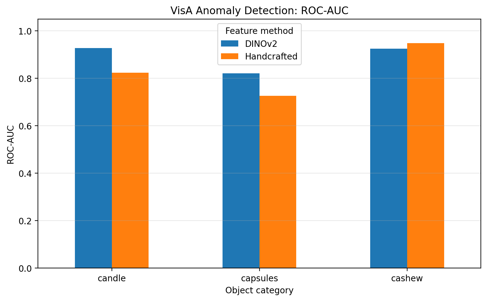
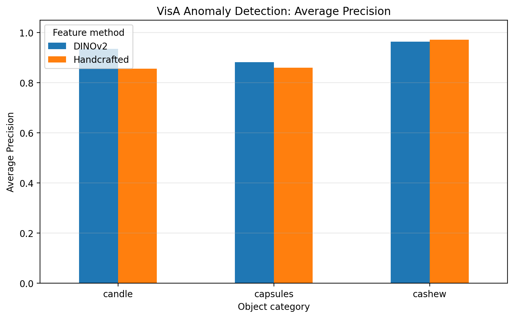

# Evaluating Self-Supervised Visual Representations for Image Anomaly Detection

## Abstract

Industrial image anomaly detection aims to identify products that differ from normal examples. This preliminary study compares a handcrafted image-feature baseline with pretrained DINOv2 visual representations using a nearest-neighbour anomaly scoring method. Experiments were conducted on three object categories from the VisA dataset: candle, capsules, and cashew. Both approaches used a fixed k-NN setting of k = 5 for the main comparison. DINOv2 achieved higher image-level ROC-AUC and Average Precision on candle and capsules, while handcrafted features performed better on cashew. Additional experiments examined sensitivity to the number of neighbours and calibrated anomaly-score thresholds using normal-only validation data. The findings are preliminary and limited to three categories.

## 1. Introduction

Image anomaly detection is important in industrial inspection, where defective products must be distinguished from normal products. A key design choice is the visual representation used to describe each image.

Simple handcrafted features summarise colour and image gradients. Pretrained visual models, such as DINOv2, provide learned representations that may capture richer visual information.

This study investigates whether pretrained DINOv2 representations improve image-level anomaly detection compared with basic handcrafted features when both use the same nearest-neighbour scoring approach.

## 2. Research Question

Do pretrained visual representations improve image-level anomaly detection compared with basic handcrafted colour and texture features when using the same nearest-neighbour scoring method?

## 3. Dataset

The experiments use the official one-class split of the VisA dataset. Three object categories were evaluated:

- Candle
- Capsules
- Cashew

The official training split contains normal images, while the test split contains both normal and anomalous images. Models are fitted using normal training images and evaluated using image-level anomaly scores on the official test split.

The dataset is not included in this repository.

Dataset source: https://github.com/amazon-science/spot-diff

## 4. Methodology

### 4.1 Handcrafted Features

A 10-dimensional feature vector was extracted from each image. It contains RGB channel means and standard deviations, grayscale mean and standard deviation, and mean absolute horizontal and vertical image gradients.

Feature standardisation was fitted using normal training data. A k-nearest-neighbour model with k = 5 assigned anomaly scores based on the mean distance to the nearest normal training samples.

### 4.2 DINOv2 Representations

The pretrained `facebook/dinov2-small` model was used to extract 384-dimensional CLS-token representations. The representations were L2-normalised before nearest-neighbour scoring.

The same k-NN setting, k = 5, was used for the main comparison. The model was not fine-tuned, and no separate anomaly classifier was trained. Experiments were run on CPU.

### 4.3 Evaluation Metrics

**ROC-AUC** measures how well anomaly scores rank anomalous images above normal images.

**Average Precision (AP)** summarises precision-recall performance. Its value depends partly on the proportion of anomalous examples in the evaluation set.

Higher values indicate better ranking performance.

## 5. Main Results

| Category | Feature Method | ROC-AUC | Average Precision |
|---|---|---:|---:|
| Candle | Handcrafted | 0.8237 | 0.8565 |
| Candle | DINOv2 | 0.9269 | 0.9348 |
| Capsules | Handcrafted | 0.7267 | 0.8599 |
| Capsules | DINOv2 | 0.8213 | 0.8818 |
| Cashew | Handcrafted | 0.9488 | 0.9714 |
| Cashew | DINOv2 | 0.9248 | 0.9643 |

### 5.1 Results Visualisation

**ROC-AUC comparison across categories**

**Average Precision comparison across categories**

### 5.2 Interpretation

For candle, DINOv2 improved ROC-AUC by 0.1032 and Average Precision by 0.0783 relative to the handcrafted baseline.

For capsules, DINOv2 improved ROC-AUC by 0.0946 and Average Precision by 0.0219.

For cashew, the handcrafted baseline performed better, with ROC-AUC higher by 0.0240 and Average Precision higher by 0.0071.

These results suggest that the relative effectiveness of the representations varies across categories. The results do not establish that one representation is universally superior.

## 6. Neighbour-Count Sensitivity

An exploratory sensitivity experiment evaluated k values of 1, 3, 5, 9, and 15 for both methods on the same official test sets.

DINOv2 maintained higher ROC-AUC and Average Precision than the handcrafted baseline for candle and capsules across the tested k values. For cashew, the handcrafted baseline achieved higher ROC-AUC at k values of 3, 5, 9, and 15, and higher Average Precision at those settings.

This analysis shows that performance depends on the category and scoring configuration. Because this sweep uses the official test set, it is treated as exploratory analysis rather than independent hyperparameter selection. The main comparison retains the prespecified k = 5 setting.

## 7. Normal-Only Threshold Calibration and Test Evaluation

A separate experiment evaluated threshold calibration using normal training images from the official VisA split. For each category, the normal training images were randomly divided into a fitting subset and a calibration subset using random seed 42. The fitting subset was used to fit the feature scaler and k-nearest-neighbour model, while the calibration subset was used exclusively to select a threshold.

The experiment used \(k=5\) and selected the 95th-percentile calibration score as the anomaly threshold. The fitted model and calibrated threshold were then evaluated on the official test set without using test labels to select the threshold.

| Category | Fit Normal Images | Calibration Normal Images | Test Images |
|---|---:|---:|---:|
| Candle | 720 | 180 | 200 |
| Capsules | 434 | 108 | 160 |
| Cashew | 360 | 90 | 150 |

### 7.1 Independent Test Results

| Category | Calibrated Threshold | Test FPR | Test TPR | ROC-AUC | Average Precision |
|---|---:|---:|---:|---:|---:|
| Candle | 1.154599 | 0.0500 | 0.5700 | 0.8163 | 0.8560 |
| Capsules | 2.130894 | 0.0000 | 0.2700 | 0.7153 | 0.8556 |
| Cashew | 1.590245 | 0.0200 | 0.4800 | 0.9480 | 0.9700 |

The results illustrate the trade-off between false-positive control and anomaly detection. The calibrated threshold produced a test false-positive rate of 5% for candle, 0% for capsules, and 2% for cashew. However, the corresponding true-positive rates were 57%, 27%, and 48%, respectively. In particular, the capsules result shows that a low false-positive rate does not necessarily imply strong anomaly detection.

ROC-AUC and Average Precision evaluate the ranking of anomaly scores across thresholds, whereas FPR and TPR evaluate predictions at the selected threshold. These metrics therefore provide complementary information.

### 7.2 Limitations

The calibration threshold was estimated from a finite sample of normal images, so the resulting test FPR is not guaranteed to equal the nominal 5% target. The observed test rates are estimates based on relatively small test subsets and may vary across different data samples.

This experiment uses handcrafted image features and a fixed value of \(k=5\). Its results should not be directly compared with the earlier baseline as if both models had been fitted on identical training data, because this experiment reserves a portion of normal training images for threshold calibration. The findings are preliminary and are limited to three VisA categories.

## 8. Limitations

- Only three VisA categories were evaluated.
- The experiments measure image-level anomaly detection, not pixel-level defect localisation.
- The handcrafted baseline uses a small set of basic image statistics and gradients.
- The method uses a simple nearest-neighbour scoring procedure.
- The neighbour-count sensitivity analysis uses the official test set and is exploratory.
- Threshold calibration uses normal-only validation data and does not establish anomaly-detection accuracy.
- Statistical significance and run-to-run variability have not been established.
- The results may depend on preprocessing, feature extraction, and scoring choices.

## 9. Future Work

Future work could evaluate more VisA categories, include additional feature representations, investigate pixel-level anomaly localisation, and use a separate labelled validation set for threshold and hyperparameter selection. Repeated experiments and statistical uncertainty estimates would also strengthen the conclusions.

## 10. Conclusion

In this preliminary evaluation, pretrained DINOv2 representations improved image-level anomaly ranking on candle and capsules, while the handcrafted baseline performed better on cashew. The category-dependent results motivate broader evaluation before drawing general conclusions about pretrained representations for industrial anomaly detection.

## Reproducibility

The experiment scripts, result tables, and visualisations are maintained in this repository. See `README.md` for environment details and instructions to run the experiments.

Main result files:

- `results/combined_results.csv`
- `results/comparison_roc-auc.png`
- `results/comparison_average_precision.png`
- `results/knn_robustness.csv`
- `results/dinov2_robustness.csv`
- `results/normal_only_validation.csv`
